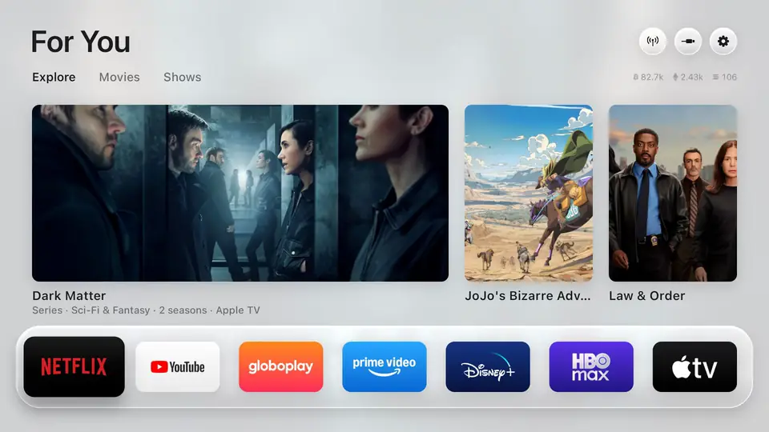

<div align="center">


# Free My TV

**A fast, ad-free home screen for Google TV, LG and Samsung TVs.**

Trending picks from your own apps, the weather at a glance, and a look that follows the sunset.<br>
Open source. No root. One button to undo.

> **This is a fork of [Free My TV](https://github.com/simbasjungles/free-my-tv).**
> This copy ([Simongonza73/TVTOKH32SM-Tv-Tokyo-Launcher](https://github.com/Simongonza73/TVTOKH32SM-Tv-Tokyo-Launcher))
> is adapted for the **TV Tokyo TVTOKH32SM** (32″, Android 9). The original MIT license and credits are kept.
> See [This fork](#this-fork) for what changed.

[Requirements](#requirements) · [Quick start](#quick-start-android-tv--google-tv) · [This fork](#this-fork) · [LG TVs](#lg-tvs-webos) · [Samsung TVs](#samsung-tvs-tizen) · [Configuration](#configuration) · [Troubleshooting](#troubleshooting)



</div>

## What you get

- **No ads.** No sponsored rows, banners or autoplaying promos.
- **Your apps, front and center.** The streaming apps you actually use, on a glass shelf. Pick them and their order on the TV.
- **Trending, not sponsored.** Fresh picks from what is trending this week and the latest releases, only from apps you already have.
- **Weather and markets, one press away.** Hour-by-hour forecast, sunrise and sunset, and live crypto prices.
- **Light by day, dark by night.** The theme follows your city's real sunset.
- **A screensaver to match.** Full-screen photos of the picks with a big glass clock.
- **Set up on the TV.** Language, city, temperature, theme, weather/crypto cards, wallpapers and shelf apps in Free My TV's own settings.
- **Safe.** No root. Nothing is uninstalled permanently. One button brings back the factory home screen.

## This fork

This repository is a personal fork of Free My TV, adapted for one low-end Android TV and kept as a working example
of adapting the launcher for a specific device.

**The TV:** TV Tokyo **TVTOKH32SM**, 32″, Android 9 (API 28) on a HiSilicon Hi3751V351 (4× Cortex-A53, ~1 GB RAM),
remote-only (leanback). The factory launcher, `com.cultraview.launcher.technical.hs351`, stays installed and untouched.

What this fork adds on top of upstream:

- **[`BootHomeService.java`](app/src/io/freemytv/BootHomeService.java)** and
  **[`BootGate.java`](app/src/io/freemytv/BootGate.java)**: an accessibility service opens the home screen about 3 seconds
  after power-on, because `BOOT_COMPLETED` only arrives after ~1 min 54 s on this TV. It only reacts to the factory
  launcher's window, opens the home screen at most once per boot, only during the first 3 minutes, then goes quiet.
  Enable it once, keeping the TV's own service:
  ```bash
  adb shell settings put secure enabled_accessibility_services com.hisilicon.rmservice/com.hisilicon.rmservice.HiRMService:io.freemytv/.BootHomeService
  ```
- **[`Style.java`](app/src/io/freemytv/Style.java)**: every color, size, radius and animation time in one file.
- **Wallpapers and a RAM note in Settings**: None / Mountains / Aurora / Zenless 1–7, and a read-only explanation of
  Android's limits on listing other apps' processes.
- **Trimmed to this TV**: fewer features than current upstream (no Trakt, Immich, sleep timer, quick settings, etc.).

Everything is reversible. To go back to the factory home screen and remove the boot service:

```bash
adb shell cmd package set-home-activity com.cultraview.launcher.technical.hs351/com.cultraview.launcher.technical.open.ui.MainActivity
adb shell settings put secure enabled_accessibility_services com.hisilicon.rmservice/com.hisilicon.rmservice.HiRMService
adb reboot
```

The second line keeps the TV's own accessibility service (everything before the colon); never set it to an empty value.
Uninstalling `io.freemytv` (`adb uninstall io.freemytv`) also returns to the factory launcher once the service is removed.

## Requirements

### At a glance

| Component | Version | Needed for | Notes |
|---|---|---|---|
| **TV** | Android TV / Google TV **8.0+ (API 26+)** | Android app | This fork targets Android 9 (API 28); compiled against API 34, target SDK 33 |
| **JDK** | **17** (Eclipse Temurin recommended) | Android build | `build.sh` needs a JDK 17+; **use 17** — that is what CI uses |
| **Android SDK** | **build-tools 34.0.0**, **platform android-34** | Android build | `aapt2`, `d8`, `zipalign`, `apksigner` |
| **Android SDK platform-tools** | current | Install on TV | Provides `adb` |
| **Git + Git Bash** | current | Windows build | `build.sh` needs bash, `sed`, `grep`, `find`, `cygpath` |
| **Python** | 3.8+ | LG/Samsung builds, tools | Standard library only for the build/install scripts |
| **OpenSSH** | current | LG install | `ssh` and `ssh-keygen` on `PATH` |
| **Node.js** | 18+ (optional) | `tools/check.sh web` | Only to run the ES5 syntax check with `acorn` |
| **Tizen Studio** | optional | Signing Samsung `.wgt` | Only needed for `tizen/build.py --sign` |
| **TMDB key** | free, optional | Trending picks | The app still works without it |
| **Watchmode key** | free, optional | Open a title inside its app | Picks open the streaming app without it |

No Gradle, no Android Studio and no third-party Java libraries are needed. Android Studio is only an easy way to install
the SDK; you can build everything from the command line.

### Android build machine

1. **Install a JDK 17** and set `JAVA_HOME` to its folder.

   - Windows: [Eclipse Temurin 17](https://adoptium.net/temurin/releases/?version=17), then set
     `JAVA_HOME=C:\Java\jdk-17` (or wherever it was installed).
   - macOS: `brew install --cask temurin@17`
   - Linux: install `openjdk-17-jdk` from your distribution.

   Check it:
   ```bash
   java -version    # should print 17.x
   javac -version   # should print 17.x
   ```

   > `build.sh` accepts JDK 17 or newer, but newer JDKs can emit class files that build-tools 34's `d8` does not
   > understand. Use **JDK 17** to reproduce the CI build.

2. **Install the Android SDK command-line tools**, then install the packages:

   ```bash
   sdkmanager "platform-tools" "build-tools;34.0.0" "platforms;android-34"
   ```

   - macOS:
     ```bash
     brew install --cask android-commandlinetools android-platform-tools
     sdkmanager "build-tools;34.0.0" "platforms;android-34"
     ```
   - Linux: install Android's command-line tools from your package manager, then run the `sdkmanager` line above.
   - Windows: install the command-line tools in `C:\Android\Sdk` (the default in `run_build.bat`), then run:
     ```bat
     %ANDROID_HOME%\cmdline-tools\latest\bin\sdkmanager.bat "platform-tools" "build-tools;34.0.0" "platforms;android-34"
     ```

3. **Set `ANDROID_HOME`** to the SDK folder and add `platform-tools` to `PATH` (for `adb`).

   ```bash
   export ANDROID_HOME="$HOME/Library/Android/sdk"   # macOS example
   export PATH="$ANDROID_HOME/platform-tools:$PATH"
   ```

   On Windows, `run_build.bat` already assumes:
   ```bat
   set "ANDROID_HOME=C:\Android\Sdk"
   set "JAVA_HOME=C:\Java\jdk-17"
   ```
   Edit those two lines if your paths are different. It also expects Git Bash at
   `C:\Program Files\Git\usr\bin\bash.exe` (or `bash` on `PATH`).

4. **Verify** that `build.sh` can find the tools:
   ```bash
   echo "$ANDROID_HOME"     # must point to the SDK
   ls "$ANDROID_HOME/build-tools"
   ls "$ANDROID_HOME/platforms"
   ```

   `build.sh` uses the newest build-tools and platform it finds. CI explicitly uses **build-tools 34.0.0** and
   **android-34**, so install those exact versions before sending a pull request.

### Windows

Use **Git Bash** (or `run_build.bat`, which calls it). Do not run `build.sh` from `cmd.exe` or PowerShell directly.

```bat
run_build.bat
```

The script sets `ANDROID_HOME`, `JAVA_HOME` and the Git Bash path, converts them with `cygpath` and runs `./build.sh`.
`adb` is only needed to install the APK, not to build it.

### LG and Samsung build machine

- **Python 3.8+** is enough for `webos/build.py` and `tizen/build.py`; they use only the standard library.
- **OpenSSH** (`ssh`, `ssh-keygen`) is needed by `webos/install.py` to reach the TV.
- **Node.js** is only needed if you run the web checks (`tools/check.sh web`); the build itself does not use it.
- **Tizen Studio** is only needed to sign a Samsung package with `tizen/build.py --sign <profile>`. The Python
  installer talks SDB directly, so Tizen Studio is not needed to install.
- **Pillow** is only needed if you regenerate art or symbols with `tools/make_art.py` / `tools/make_zones.py`.

## Quick start (Android TV / Google TV)

About ten minutes. You need a Google TV or Android TV (Android 8 or newer) and a computer on the same Wi-Fi.

### 1. Prepare the TV

1. Settings → System → About → press **Android TV OS build** 7 times.
2. Settings → System → Developer options → turn on **USB debugging** (and **Network debugging** if your TV shows it).
3. Note the TV's IP address: Settings → Network & Internet.

### 2. Build

```bash
git clone https://github.com/Simongonza73/TVTOKH32SM-Tv-Tokyo-Launcher.git
cd TVTOKH32SM-Tv-Tokyo-Launcher
./build.sh
```

The first run creates `config.properties` from `config.example.properties`. Edit it (city and optional keys), then build
again:

```bash
./build.sh
```

The result is **`FreeMyTV.apk`** in the repository root.

On Windows, run `run_build.bat` instead of `./build.sh` (it uses Git Bash internally).

### 3. Install

```bash
adb connect 192.168.1.50:5555
adb install -r FreeMyTV.apk
```

On TCL TVs, also let the app run in the background (TCL blocks it by default, and the switch never starts):

```bash
adb shell "appops set io.freemytv AUTO_START allow || appops set io.freemytv APP_AUTO_START allow"
```

### 4. Make it the home screen

On the TV, open **Free My TV** → **Home Screen** → **Free My TV**. Android asks **Allow USB debugging?** for Free My TV
itself: tick **Always allow** and accept. The app uses the TV's own ADB at `127.0.0.1:5555` to switch the home screen,
the screensaver and the apps it turns off — nothing listens on the network.

For this fork, also enable the early boot service (keeps the TV's own accessibility service):

```bash
adb shell settings put secure enabled_accessibility_services com.hisilicon.rmservice/com.hisilicon.rmservice.HiRMService:io.freemytv/.BootHomeService
```

### 5. Go back

On the TV: **Free My TV** → **Home Screen** → **Original**. The factory home screen, screensaver and every app come back.
The boot service is disabled separately with the command in [This fork](#this-fork).

If the new home screen ever crashes three times in five minutes, it switches back by itself.

## Configuration

The first build creates `config.properties` (ignored by git) from [`config.example.properties`](config.example.properties).
The same file is used by the Android, LG and Samsung builds. Most values can also be changed on the TV in
**Free My TV → Home Settings**; the TV's choice wins.

| Key | What it does | Default |
|---|---|---|
| `tmdb_key` | Free TMDB key, for the picks | empty |
| `tmdb_region` | Your country (two letters): which titles are on which app | `US` |
| `watchmode_key` | Optional free [Watchmode](https://api.watchmode.com/) key: a pick opens the title's page in its app | empty |
| `latitude`, `longitude` | Your city, for weather and sunset | New York |
| `city` | Name shown on the weather card | `Weather` |
| `hide_animation` | Leave cartoons and anime out of the picks | `false` |
| `language` | `auto` (follows the TV), or `en`, `pt`, `es`, `de`, `ru`, `fr`, `ja`… | `auto` |
| `show_crypto` | Show Binance crypto prices on home and screensaver | `true` |
| `currency` | Crypto prices in `USD`, `EUR`, `BRL`… | `USD` |
| `temperature` | `C`, `F` or `auto` | `auto` |
| `disable_assistant` | Also turn off Google Assistant (the remote's mic button stops working) | `false` |
| `hide_services` | Streaming services to leave out of the picks even when their app is on the TV (`netflix`, `prime`, `disney`…), comma separated. Google TV only | empty |
| `hide_apps` | Apps to leave out of the shelf, All Apps and the picks, by id or name (part of it), comma separated. LG and Samsung only | empty |
| `version_code` | Android `versionCode`; **bump it before every reinstall** so `adb install -r` accepts the update | `2` |
| `version_name` | Android `versionName` | `1.1` |

Changed something? Run `./build.sh` and install again. Keep **`freemytv.keystore`**: updates must be signed with it.

### The TMDB key

Free, and it takes two minutes:

1. Create an account at [themoviedb.org](https://www.themoviedb.org/signup).
2. Open [Settings → API](https://www.themoviedb.org/settings/api) and request a developer key.
3. Paste the **API Read Access Token** (or the **API Key**) after `tmdb_key=`.

Without it, the home screen still works, just without the trending picks. Your key stays in `config.properties`, which is
in `.gitignore`.

### Opening a title, not just its app (optional)

With a free [Watchmode](https://api.watchmode.com/) key in `watchmode_key=`, a pick opens its own page in the streaming
app instead of the app's home. The free plan (2,500 credits a month) is enough: each title costs two requests the first
time and is remembered after that. Where the app does not accept the title's web address, the pick just opens the app,
as without a key.

## LG TVs (webOS)

The same home screen as an LG app: picks, the glass shelf, the drawer with inputs, weather, prices, day and night, Home
Settings and the shelf editor. It installs through LG's own Developer Mode; nothing is rooted or changed on the TV. LG's
home screen stays where it is, and Free My TV is one press of a number key away.

You need an LG TV (webOS 3 or newer), a computer on the same Wi-Fi, **Python 3** and **OpenSSH**.

1. **On the TV**, open the LG Content Store and install **Developer Mode**. Sign in with a free
   [LG developer account](https://webostv.developer.lge.com), turn on **Dev Mode Status** (the TV restarts), then turn on
   **Key Server**. Note the IP address and the passphrase it shows.
2. **On the computer**, build the package:
   ```bash
   git clone https://github.com/Simongonza73/TVTOKH32SM-Tv-Tokyo-Launcher.git
   cd TVTOKH32SM-Tv-Tokyo-Launcher
   python3 webos/build.py
   ```
   `config.properties` works as for Android. The result is **`FreeMyTV-webos.ipk`**.
3. **Install** (asks for the TV's passphrase the first time; updates do not):
   ```bash
   python3 webos/install.py 192.168.1.50
   ```
4. **On the TV**, while Free My TV is open, **hold a number key** on the remote. From then on, that key opens it from
   anywhere.

To preview the web app in a browser without a TV:

```bash
python3 webos/build.py --preview
# open out/webos/index.html, or serve out/webos
```

Developer Mode lasts about 40 days: open the Developer Mode app now and then and press **EXTEND**. To remove Free My TV:

```bash
python3 webos/install.py 192.168.1.50 --uninstall
```

If the TV's key changed, delete `~/.ssh/freemytv_webos_<IP>` and run the installer again.

## Samsung TVs (Tizen)

The same home screen as a Samsung app, with everything the LG one has: picks, shelf, inputs, weather, prices, day and
night, and its own settings. It installs through Samsung's own Developer Mode; nothing is rooted or changed, and
Samsung's home screen stays where it is.

You need a Samsung TV from **2017 or newer (Tizen 3+)** and a computer on the same Wi-Fi.

1. **On the TV**, open **Apps** and type `1 2 3 4 5` on the remote. Turn **Developer mode** on, type your computer's IP
   address in **Host PC IP**, and restart the TV.
2. **On the computer**, build and sign the package:
   ```bash
   python3 tizen/build.py --sign <profile>
   ```
   `<profile>` is a certificate profile made in **Tizen Studio** (or Samsung's `tizen-sdk-skills`). If Tizen Studio is
   installed somewhere other than `~/tizen-studio`, `~/tizen-sdk` or `C:\tizen-studio`, set `TIZEN_STUDIO` to its folder.
   The result is **`FreeMyTV-tizen.wgt`**.
3. **Install** (Python only; it speaks SDB directly, no Tizen Studio needed):
   ```bash
   python3 tizen/install.py 192.168.1.50
   ```
4. **Straight to it:** in the TV's settings, under Start Screen Options, turn on **Autorun Last App**; the TV turns on
   into Free My TV.

To build without signing (for inspection or TizenBrew):

```bash
python3 tizen/build.py
```

[**TizenBrew Installer**](https://github.com/reisxd/TizenBrewInstaller/releases/latest) can also install the app on
2023 and newer TVs and signs it with your Samsung account. This Python installer is an alternative that works without
Tizen Studio and without Rosetta on Apple Silicon.

To remove it:

```bash
python3 tizen/install.py 192.168.1.50 --uninstall
```

If the TV says *different certificate*, remove the app on the TV (**Apps → Settings → Free My TV → Delete**) and install
again with the same certificate as before. TVs only update an app signed with the same key.

## Checks and CI

What CI runs on every pull request ([`.github/workflows/check.yml`](.github/workflows/check.yml)) is also what you can
run before pushing:

```bash
tools/check.sh           # everything
tools/check.sh android   # only the Android build (needs JDK + Android SDK)
tools/check.sh web       # translations, LG/Samsung packages and ES5 checks (needs Python 3 + Node)
```

The Android job uses **Temurin 17**, **build-tools 34.0.0** and **android-34**, so a build that passes locally with
newer tools can still fail in CI. The web check validates the translation catalogues and makes sure `web/*.js` stays
ES5-compatible, because webOS 3 and Tizen 3 run a Chromium from 2015–2017.

## How it works

- **A plain Android app, no Gradle, no libraries.** [`build.sh`](build.sh) runs
  `aapt2 → javac → d8 → zipalign → apksigner` and produces a small APK.
- **It uses the TV's own ADB from inside the TV.** The app connects to `127.0.0.1:5555` with its own key (that is the
  *Allow USB debugging?* prompt) and runs the same commands you would: `cmd package set-home-activity`,
  `settings put secure screensaver_components`, `pm disable-user`. Nothing listens on the network.
- **Drawn by hand on one Canvas**, with Android 13 shaders for the frosted glass and the sky (plain fills on Android
  8–12, with lighter shadows on older GPUs).
- **A safety net.** A watchdog in a separate process brings back the stock home screen after three crashes in five
  minutes, and a boot check keeps your choice after TV updates.
- **On LG and Samsung, the same design in plain HTML, CSS and JavaScript** ([`web/`](web)), written for the Chromium of
  older TVs, with no frameworks. [`webos/build.py`](webos/build.py) packs it with `config.properties` into an `.ipk`
  without LG's tools; on LG it lists and opens apps through the TV's own service bus (Luna).
  [`tizen/build.py`](tizen/build.py) packs the same app into a Samsung `.wgt`.
- **Data** from TMDB (trending, new releases, which app streams what in your country), Open-Meteo (forecast, sunrise and
  sunset), and optionally Binance (24-hour prices when `show_crypto=true`).

### Project layout

| Path | What it is |
|---|---|
| [`app/src/io/freemytv/HomeView.java`](app/src/io/freemytv/HomeView.java) | The Android home screen |
| [`app/src/io/freemytv/HomeMode.java`](app/src/io/freemytv/HomeMode.java) | Switching between Free My TV and Original |
| [`app/src/io/freemytv/Adb.java`](app/src/io/freemytv/Adb.java) | The TV's own ADB, from inside the TV |
| [`app/src/io/freemytv/Recs.java`](app/src/io/freemytv/Recs.java) | The picks (TMDB) |
| [`app/src/io/freemytv/HomeData.java`](app/src/io/freemytv/HomeData.java) | Weather and prices |
| [`app/src/io/freemytv/HomeApps.java`](app/src/io/freemytv/HomeApps.java) | The shelf, inputs and All Apps |
| [`app/src/io/freemytv/DreamView.java`](app/src/io/freemytv/DreamView.java) | The screensaver |
| [`app/src/io/freemytv/SettingsActivity.java`](app/src/io/freemytv/SettingsActivity.java) | The settings screen (the app's icon) |
| [`app/src/io/freemytv/Prefs.java`](app/src/io/freemytv/Prefs.java) | Settings changed on the TV |
| [`app/src/io/freemytv/Style.java`](app/src/io/freemytv/Style.java) | Colors, sizes, radii and animation times |
| [`app/src/io/freemytv/Watchdog.java`](app/src/io/freemytv/Watchdog.java) | The safety net |
| [`web/home.js`](web/home.js) | The home screen on LG and Samsung TVs |
| [`web/tv.js`](web/tv.js) | The TV's apps and inputs, on LG and Samsung |
| [`webos/build.py`](webos/build.py), [`webos/install.py`](webos/install.py) | The LG package and its installer |
| [`tizen/build.py`](tizen/build.py), [`tizen/install.py`](tizen/install.py) | The Samsung package and its installer |
| [`tools/check.sh`](tools/check.sh) | The checks CI runs |
| [`app/assets/i18n/`](app/assets/i18n) | Translation catalogues |

## Troubleshooting

| Problem | Fix |
|---|---|
| `Android SDK not found` | Set `ANDROID_HOME` (or `ANDROID_SDK_ROOT`) to the SDK folder; make sure `build-tools/` exists inside it |
| `Android platform not found` | Run `sdkmanager "platforms;android-34"` |
| `JDK not found` | Install JDK 17 and set `JAVA_HOME`; make sure `$JAVA_HOME/bin/javac` exists |
| `d8` / `apksigner` not found on Windows | Use `run_build.bat` or Git Bash; `build.sh` adds `.bat` automatically |
| `adb: command not found` | Add `$ANDROID_HOME/platform-tools` to `PATH` |
| `INSTALL_FAILED_VERSION_DOWNGRADE` | Bump `version_code` in `config.properties` and rebuild |
| Update rejected because of a signature | Always keep and reuse `freemytv.keystore`; uninstall the old app only if you accept losing its settings |
| Icons/fonts missing in a Windows-built APK | Use the provided `build.sh`/`run_build.bat`; it fixes aapt2's backslash asset paths automatically |
| The boot service stops after a TV update | Re-run the `enabled_accessibility_services` command in [This fork](#this-fork), keeping the TV's own service before the colon |
| LG installer asks for a passphrase again | Delete `~/.ssh/freemytv_webos_<IP>` and run it again; the new passphrase is in Developer Mode |
| LG Developer Mode expired | Open the Developer Mode app on the TV and press **EXTEND** |
| Samsung says `different certificate` | Remove Free My TV on the TV, then install again with the same signing profile |
| Samsung package is unsigned | Build with `python3 tizen/build.py --sign <profile>`; TVs only install signed packages |
| `tools/check.sh web` fails on a JS file | The code must stay ES5; avoid `let`/`const`, arrow functions, `Promise`, `fetch`, `Map`, `includes`, etc. in `web/` |

## Privacy

No accounts, no analytics, no tracking. The app talks to TMDB, Open-Meteo (with the coordinates you set, or your time
zone's main city), Binance only when `show_crypto=true`, and Watchmode only when you set a `watchmode_key`. Your settings
stay on your computer and your TV.

## Credits

- Original project: [Free My TV](https://github.com/simbasjungles/free-my-tv) by [@simbasjungles](https://github.com/simbasjungles).
- Built with [Claude Code](https://claude.com/claude-code).
- The LG version builds on what [@danielthejoker18](https://github.com/danielthejoker18) found in
  [FreeMyTvWebOS](https://github.com/danielthejoker18/FreeMyTvWebOS) (MIT): installing through Developer Mode and opening
  apps through the TV's service bus.
- On Samsung TVs it can install with [TizenBrew Installer](https://github.com/reisxd/TizenBrewInstaller) by
  [@reisxd](https://github.com/reisxd).
- This product uses the TMDB API but is not endorsed or certified by [TMDB](https://www.themoviedb.org/).
- Links to titles in streaming apps by [Watchmode](https://api.watchmode.com/).
- Weather data by [Open-Meteo.com](https://open-meteo.com/) (CC BY 4.0). Prices from the
  [Binance](https://www.binance.com/) public API.
- Icons: [Material Symbols](https://fonts.google.com/icons) (Apache 2.0). Font: [Inter](https://rsms.me/inter/)
  (SIL OFL 1.1). Coin logos: [cryptocurrency-icons](https://github.com/spothq/cryptocurrency-icons) (CC0). Samsung app
  logos: [Simple Icons](https://simpleicons.org) (CC0).
- Not affiliated with Google, TCL, LG, Samsung or any streaming service. App names and logos belong to their owners.

## License

[MIT](LICENSE). Fork it, change it, ship it.
